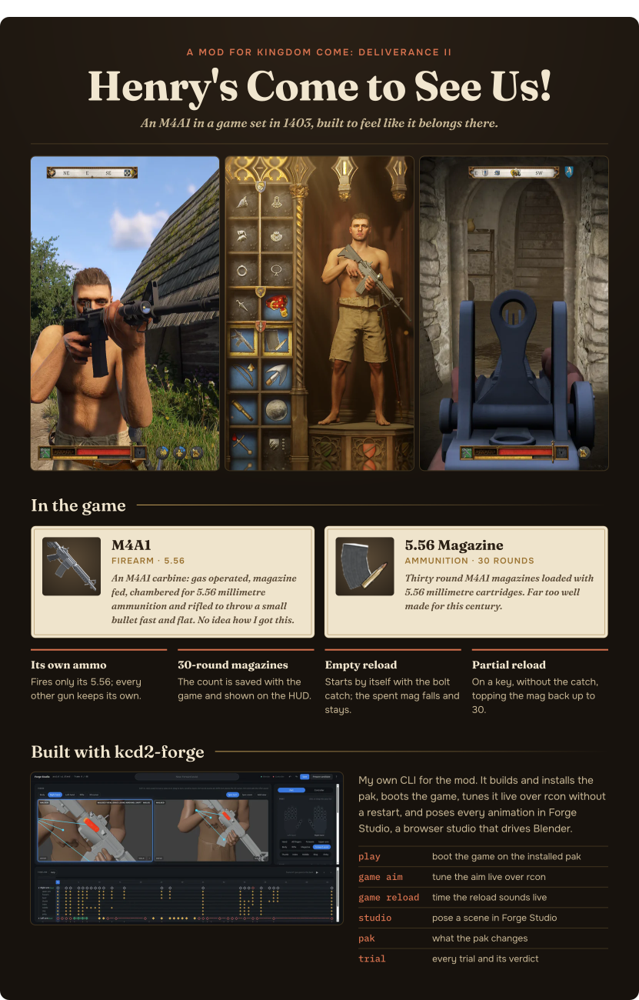

## Download

**[Download henrys-come-to-see-us-6.zip](https://github.com/KMRH47/henrys-come-to-see-us/releases/download/v6/henrys-come-to-see-us-6.zip)**

Unzip it and run `install_windows.bat` on Windows or `install_linux.sh` on Linux.
The mod page is on [Nexus Mods](https://www.nexusmods.com/kingdomcomedeliverance2/mods/3886).

This repo holds the parts of the mod that were made for it.

## What is here

| Folder | What it holds |
|---|---|
| `plugin/` | The native plugin (`m4_autofire.asi`) in C. It adds full auto fire, the M4's own ammo, damage and sound, and the reload and aim fixes. |
| `mod/` | The mod's Lua scripts, item, weapon and ammo tables, sound and particle setup, round counter and text. |
| `model/` | The M4 model in Blender, with its baked textures packed in. |
| `sounds/` | The shot and reload sounds. |
| `install/` | The Windows and Linux installers shipped in the Nexus zip. |

## What is not here

The animations, the in-game model export and the animation database are built on top of the game's own files.
Those belong to Warhorse Studios, so they are not in this repo.
You cannot rebuild the full mod from this repo alone; use the download above to play.

## Build the plugin

Install [Zig](https://ziglang.org/) 0.14, then run:

```
plugin/build.sh
```

It writes `plugin/m4_autofire.asi`.
The game loads it through Ultimate ASI Loader, with `m4_autofire.ini` next to it.

## Credits

- Ultimate ASI Loader by ThirteenAG (MIT license), shipped in the Nexus zip.
- The sounds were generated with Stable Audio 3 Small. Powered by Stability AI.
- The model, plugin and scripts were made for this mod.

## License

MIT, see `LICENSE`.
